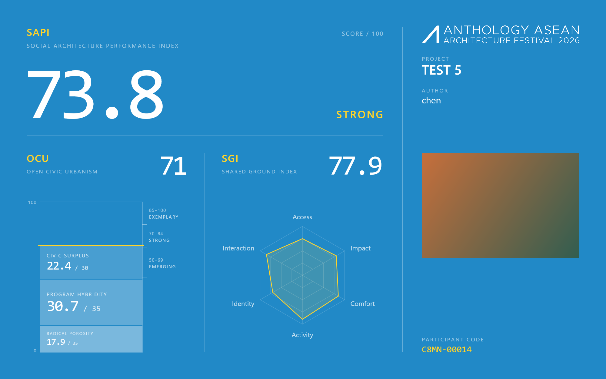
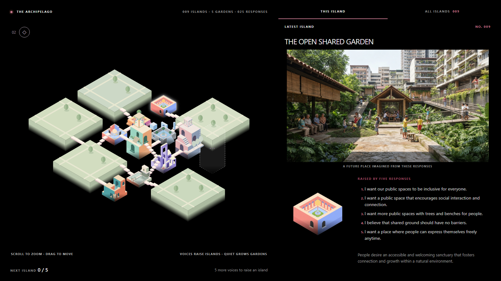
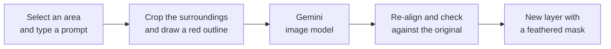

# Hi, I'm Shuhan Chen

Architectural designer (RIBA Part 2) at WTA Design Studio, Philippines. I work on hospitality, residential, F&B and civic projects in Revit, Rhino and Grasshopper, and I build AI tools for design and exhibitions.

**How I build.** I don't write code by hand. I decide what a tool has to do: the rules, the workflow, the edge cases and how to check the result. AI coding agents (Claude Code, Codex) write the code. I test every change and decide what ships.

The three projects below are all in real use. Their source code is private; I'm happy to walk through any of them in a call.

---

## SAPI: AI evaluation platform for an architecture festival

**Live at Anthology ASEAN Architecture Festival 2026** · Aug–Oct 2026 · ~200 AI evaluations

Architects submit a project with drawings, images and PDFs. The platform checks that the material is architectural, then AI scores it against SAPI (Social Architecture Performance Index), 32 metrics on how well a building serves the public. The result appears as a card on the festival screen.

What I decided:

- **The AI never does the maths.** It picks an evidence-based band for each metric, and code computes every total. One canonical rubric covers all 32 metrics and sets a single rule for what "no evidence" scores.
- **Repeat runs agree.** Scores drifted when the same project was evaluated twice. I pinned the model settings, and now repeat runs differ by at most one band on borderline evidence, and only rarely.
- **The AI can only cite what it was shown.** I closed a gap that let it quote material the participant never uploaded.
- **It survives a public event.** Uploads are security-checked before the AI sees them, and the platform has bot protection, per-visitor rate limits, an admin login, recovery after a dropped connection and an optional staff review step.

*Next.js · TypeScript · PostgreSQL · Gemini / GLM · DigitalOcean*

---

## Living Anthology: an archipelago grown from visitors' voices

**Interactive installation, Anthology ASEAN Architecture Festival 2026** · Sep–Oct 2026

Visitors answer by QR code. Every five responses, AI reads them and writes a title and a theme for an island. It then picks one of 12 island forms and 8 colour palettes, draws the island and renders the place as it might look in a Southeast Asian city. Staff approve each island before it rises onto the projected map, and a bridge links it to a neighbour. When the room is quiet, gardens grow instead.

What I decided:

- **Control the image model through its inputs, not just the prompt.** Tests showed the model edits the image it is given rather than redrawing it. So each island gets its own grey massing guide and only loose colour swatches, never a whole building to copy. Every island comes out different in a consistent style.
- **Measure, don't trust.** The model moves doorways around, so each generated image is measured to find the real door, and the bridge lands there.
- **Plan for the venue.** An offline display kit keeps the projector running on an unreliable network.

*Node.js · JavaScript · Python image processing · Gemini*

---

## Generative Fill for PhotoCraft

**A feature on my fork of [PhotoCraft](https://github.com/storytold/photocraft)**, an open-source image editor written in Rust · Oct 2026

Select an area, type what should be there, and Gemini fills it to match the surrounding image. The result lands on a new masked layer, so the original pixels never change.

The principle: **don't rely on the model obeying; make its mistakes harmless.**

- Gemini takes no pixel mask. I tried a second image with a coloured overlay and then a black-and-white mask, and both leaked into the result. The final version sends one image with a red outline drawn *outside* the selection. Even if the model keeps the line, the mask hides it.
- The model often shifts the picture by a few pixels. The result is re-aligned against a ring around the selection, and it is rejected and retried once if it doesn't match the original.

*Rust · Gemini API*

---

## Next: Revit automation

I'm working on an agent that applies red-line markups from PDFs and screenshots to Revit 2023 models. It is in the feasibility stage.

---

**Architecture:** Revit · Rhino · Grasshopper · SketchUp · QGIS 
**Education:** MArch (RIBA Part 2), 2024
